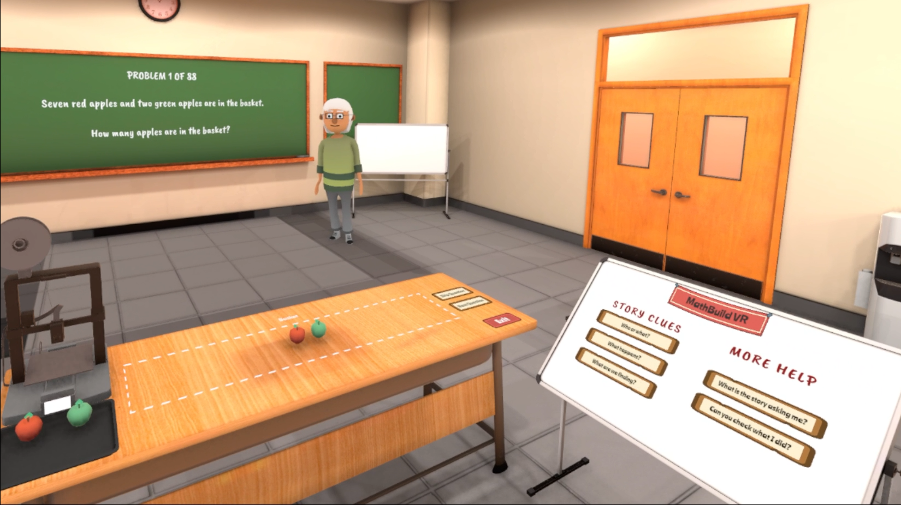
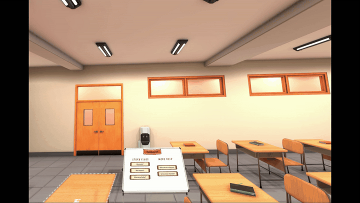
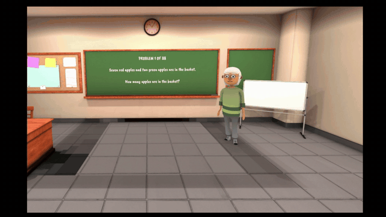
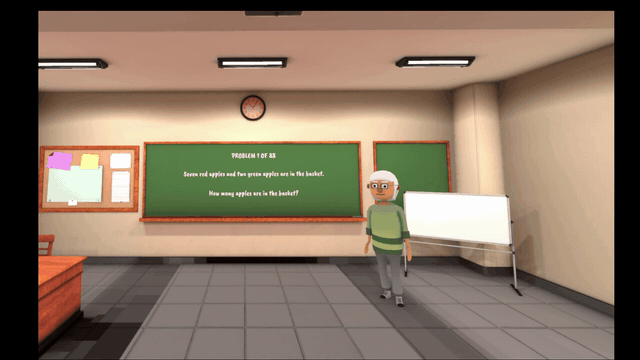

<h1 align="center">🧩 MathBuild VR</h1>

<h3 align="center">Spatial Grounding and Mathematical-Focus Containment in View-Conditioned VR Tutoring</h3>

<p align="center"><strong>A virtual reality mathematics environment with ViewTutor, a mathematically verified, view-conditioned LLM tutoring backend.</strong></p>

<p align="center">
  
  
  
  
</p>

<p align="center">
  <a href="#-overview">Overview</a> ·
  <a href="#-how-it-works">System</a> ·
  <a href="#-quick-start">Quick start</a> ·
  <a href="#2-reproduce-the-papers-reported-statistics-no-api-key-required">Reproduce results</a> ·
  <a href="#-repository-guide">Research materials</a>
</p>


---

## ✨ Overview

**MathBuild VR** lets learners represent elementary mathematical word problems by arranging three-dimensional objects in labeled workspace regions. Its tutoring component, **ViewTutor**, separates deterministic checking of the mathematical construction from language-model-generated hints. A compact **visibility snapshot** allows hints to account for whether relevant workspace regions are visible, partially visible, or outside the learner's current view.

The accompanying research examines two different questions:

- **Spatial grounding:** Does a hint's reference identify an appropriate region and agree with the recorded view?
- **Mathematical-focus containment:** Does the mathematical issue addressed by a hint remain stable when the view changes but the construction does not?

> **Research scope:** The reported experiments use scripted visibility snapshots, not learner trials. This repository does **not** claim measured improvements in learning outcomes or pedagogical effectiveness.

## 🎬 MathBuild VR in action

<div align="center">
  <a href="media/hero.png"></a>
  <br>
  <sub>MathBuild VR running on Meta Quest 3 — classroom, mathematical workspace, and tutor interface.</sub>
</div>

### 🎮 Experience the environment

<table width="100%">
  <tr>
    <th width="33%" align="center">👋 Meet the tutor</th>
    <th width="34%" align="center">🧱 Construct with objects</th>
    <th width="33%" align="center">🎛️ Explore help controls</th>
  </tr>
  <tr>
    <td align="center"><a href="media/welcome.gif"></a></td>
    <td align="center"><a href="media/interact.gif"></a></td>
    <td align="center"><a href="media/controls.gif"></a></td>
  </tr>
  <tr>
    <td align="center">Explore the virtual classroom.</td>
    <td align="center">Build mathematical representations.</td>
    <td align="center">Request assistance and navigate activities.</td>
  </tr>
</table>

> **Demo scope:** These clips show the implemented VR interface and interactions. For view-conditioned hint examples and their evaluation, see [`examples/example_hints.json`](examples/example_hints.json) and the [supplementary methods](paper/Supplementary_Material.pdf).

## 🧠 How it works

```text
Meta Quest 3 / MathBuild VR
   ├─ Learner construction ──► Deterministic mathematical evaluator
   │                             └─ Verified status + discrepancies
   └─ Visibility snapshot ──► Visibility classes + label-history flags
                                      │
                          ViewTutor prompt construction
                                      │
                        LLM hint generation (non-correct states)
                                      │
                              Answer protection
                                      │
                            Spoken + displayed hint
```

A correct construction receives fixed confirmation without an LLM call. For incomplete or incorrect constructions, ViewTutor uses verified mathematical facts and, in the view-conditioned setting, region visibility classes and label flags. The LLM does **not** receive raw headset imagery, object coordinates, camera pose, or the numerical visibility fraction.

**Supported problem types:** join, remove, equal groups, equal sharing, and part-to-part ratio. The application contains **88 mathematical word problems adapted from ASDiv**.

<details>
<summary><strong>What exactly is in a visibility snapshot?</strong></summary>

The headset estimates a per-region visible fraction from **nine sample points** on the region's top face, accounting for viewport inclusion and occlusion. The backend converts that information into the prompt-side classes **hidden** (`f < 0.10`), **partially visible** (`0.10 ≤ f < 0.70`), and **mostly visible** (`f ≥ 0.70`), together with label-visibility and label-history flags.

See [`examples/visibility_snapshots.json`](examples/visibility_snapshots.json) for serialized examples. The evaluation uses directly assigned, scripted fractions rather than live headset sampling.

</details>

## 📊 Research at a glance

The preliminary evaluation used **20 non-correct construction states**, **five scripted view conditions**, and **two generations per state/view/condition**. It produced **200 view-conditioned** and **200 view-blind** hints.

| Measure | Reported result |
|---|---:|
| Generated and annotated hints | **400** |
| View-conditioned hints with specific workspace references | **143 / 200 (72%)** |
| Grounded success among evaluable reference-making hints | **138 / 142 (97%)** |
| Grounded yield across evaluable hints | **138 / 199 (69%)** |
| Mathematical-focus changes across view conditions | **15 / 120 (13%)** |
| Mathematical-focus changes within the same view | **1 / 60 (2%)** |

**Key observation:** All 15 cross-view mathematical-focus changes involved **partial visibility** and came from **five construction states**. High spatial-grounding success therefore did not imply stable mathematical focus across views.

These are **descriptive, preliminary findings**: the 20 states were used during prompt development, and one partially blinded author annotated the outputs. The experiment does not isolate the effect of visibility fields from the effect of spatial-wording instructions.

## 🚀 Quick start

### 1. Run the ViewTutor backend locally

From the repository root, use **PowerShell**:

```powershell
cd ViewTutor-backend
py -m venv .venv
.\.venv\Scripts\Activate.ps1
python -m pip install -r requirements.txt
Copy-Item .env.example .env
python -m uvicorn app.main:app --host 127.0.0.1 --port 8000
```

The provided `.env.example` sets `USE_MOCK_LLM=1` by default, so you can start the backend **without an OpenAI API key**. The health endpoint is `http://127.0.0.1:8000/api/health`; interactive API documentation is available at `http://127.0.0.1:8000/docs`.

To run the backend tests, open a second terminal inside `ViewTutor-backend/` and run:

```powershell
python -m pytest
```

For real model calls, configure your own key in the local `.env` and set `USE_MOCK_LLM=0`. **Never commit `.env` or generated logs.** A newly run model may produce different text from the frozen evaluation outputs.

> The published evaluation used the specific model and generation settings documented in [`paper/Supplementary_Material.pdf`](paper/Supplementary_Material.pdf). The current backend configuration and prompt version can differ from the frozen evaluation prompt files.

### 2. Reproduce the paper's reported statistics (no API key required)

The analysis script uses the Python standard library and the **released annotated CSVs**:

```powershell
cd evaluation
python reproduce_results.py
```

This prints RQ1 reference coverage, grounding metrics and orientation counts; RQ2 pairwise focus and target changes; and descriptive **95% percentile bootstrap intervals** over construction states (fixed seed, 100,000 resamples). The script analyzes the released annotations; it does **not** regenerate or independently re-annotate the 400 hints.

## 🗂️ Repository guide

| Path | Contents |
|---|---|
| [`ViewTutor-backend/`](ViewTutor-backend/) | Python/FastAPI tutoring service, deterministic evaluator, LLM integration, answer protection, question bank, sample captures, and tests |
| [`unity-integration/Scripts/`](unity-integration/Scripts/) | Selected MathBuild VR C# application and integration source; **not a complete Unity project** |
| [`evaluation/evaluation_data.csv`](evaluation/evaluation_data.csv) | All **400 generated hints** and their annotations |
| [`evaluation/target_pair_classification.csv`](evaluation/target_pair_classification.csv) | **76** manually classified differing-target pairs |
| [`evaluation/annotation_guidelines.md`](evaluation/annotation_guidelines.md) | Annotation criteria and metric definitions |
| [`evaluation/reproduce_results.py`](evaluation/reproduce_results.py) | Reproduces reported aggregate counts and bootstrap intervals |
| [`prompts/`](prompts/) | Frozen view-conditioned and view-blind evaluation prompt files |
| [`examples/visibility_snapshots.json`](examples/visibility_snapshots.json) | Five scripted view examples, including request-side and prompt-side representations |
| [`examples/example_hints.json`](examples/example_hints.json) | Unedited hint examples, grounding failures, and a focus-change case |
| [`paper/Supplementary_Material.pdf`](paper/Supplementary_Material.pdf) | Detailed pipeline, prompt texts, evaluation states, annotation protocol, and extra results |
| [`media/`](media/) | Actual classroom screenshot and three short recorded feature GIFs |

### Frozen record and naming conventions

The software is presented as **MathBuild VR** (application) and **ViewTutor** (tutoring backend). Historical source identifiers may still contain earlier names, and the archived evaluation data use `reference` for the **view-blind** condition. Those original experimental identifiers are retained to preserve traceability; `reference` does **not** indicate that the model received a visibility snapshot.

The frozen prompt texts reflect the instructions actually used in the study, including the noted reference to an `arrangement_description` field that was not present in the serialized evaluation payload. See Supplementary Material §S3.4. Do not silently rewrite these historical instructions when reproducing the study.

## 🔍 Scope and limitations

- **Unity release:** The full VR application, scenes, and purchased third-party assets are **not distributed**. The Unity scripts are released as reference/integration source and should not be described as a directly buildable standalone Unity project.
- **Results reproduction:** The supplied CSVs and script reproduce the **reported analysis**, without headset access or an API key. Re-running model generation requires a supported API and can produce different hints.
- **Evaluation scope:** The visibility snapshots were **scripted**; one of the five views (hidden-unseen) is a synthetic stress test. No learner interaction or learning outcomes were evaluated.
- **Annotation:** The original annotations were produced by one partially blinded author. Identical-target pairs were assumed to preserve mathematical focus; classifications were not independently checked.
- **Licensing and redistribution:** The original VR environment uses third-party dependencies. Only code and assets that can legally be distributed should be committed; adding a `LICENSE` file should reflect the rights actually held for the released material.

---

<p align="center">
  <strong>MathBuild VR</strong> · <strong>ViewTutor</strong><br>
  <em>Build mathematical representations. Verify the state. Ground the hint in the view.</em>
</p>
